# Developer & AI Agent Guide (AGENTS.md)

Welcome to the **Shangdaren (上大人)** repository. This document serves as the primary technical specification, architecture manual, and operational reference for autonomous AI agents and software engineers working in this codebase.

---

## 1. Project Purpose & Engineering Philosophy

**Shangdaren (上大人)** is a browser-based, offline-capable Progressive Web Application (PWA) implementing the ancient 3-player Chinese literacy card game originating from Hubei province. The game utilizes a 96-card deck derived from a 24-character Confucian literacy mnemonic arranged into 8 suits of 3 characters each.

### Core Architectural Principles
1. **Zero External Dependencies**: Pure vanilla JavaScript (ESM), HTML5, and CSS3. **Never introduce bundlers (Webpack, Vite, Rollup, Parcel), transpilers (Babel), or npm runtime dependencies** without explicit instruction. The project must remain directly runnable by any static HTTP file server.
2. **Native Web Standards**: Uses native ES Modules (`<script type="module">` in HTML, `"type": "module"` in `package.json`), CSS Custom Properties (CSS variables), glassmorphism (`backdrop-filter`), CSS Scroll Snap, and native Service Workers.
3. **Strict Separation of Concerns**:
   - `rules.js`: Pure functional domain logic and algorithms (partitioning, validity, scoring). No side effects, no state, no DOM access.
   - `game.js`: State machine, turn sequencing, event emission, and bot automation. No DOM manipulation.
   - `main.js`: Presentation layer, DOM binding, animation orchestration, responsive carousel, and input handling.
   - `player.js`, `card.js`, `deck.js`: Domain state models.
4. **Bilingual Parity**: All player-facing text must support both Simplified Chinese (`zh`) and English (`en`).
5. **Deterministic Seeded PRNG**: Shuffling and gameplay randomness rely on an encapsulated instance-level PRNG within `Deck` (Mulberry32-variant) seeded via `crypto.getRandomValues`, ensuring reproducibility and test isolation.

---

## 2. Codebase Anatomy & Architecture

### 2.1 File Mapping
```
shangdaren/
├── index.html              # Main game shell and DOM scaffolding
├── about.html              # Cultural background, Confucius biography & history (bilingual)
├── how-to.html             # Rules, meld illustrations, and scoring table (bilingual)
├── versions.html           # Version history and planned roadmap (bilingual)
├── manifest.json           # PWA metadata for installation & display modes
├── sw.js                   # Service Worker with cache-first asset strategy
├── package.json            # Node.js ESM configuration ("type": "module")
├── src/
│   ├── css/
│   │   └── style.css       # Design system, glassmorphism, responsive styles & carousel
│   └── js/
│       ├── constants.js    # Centralized timing and UI delay constants (GAME_SPEEDS, UI_DELAYS)
│       ├── translations.js # Bilingual dictionary (zh & en)
│       ├── utils.js        # Seed generation utility (crypto.getRandomValues with fallback)
│       ├── card.js         # Card model, suit definitions, and character constants
│       ├── deck.js         # 96-card deck initialization, PRNG & Fisher-Yates shuffle
│       ├── rules.js        # Pure game rules, perfect partition search & scoring engine
│       ├── player.js       # Player state container, hand operations & local stats
│       ├── game.js         # Turn loop orchestrator, state machine & event emitter
│       └── main.js         # Presentation layer, reactive renderer & mobile carousel
```

### 2.2 Layered System Architecture

```
┌─────────────────────────────────────────────────────────────────┐
│                    Presentation Layer (UI)                      │
│     index.html  │  src/css/style.css  │  src/js/main.js         │
│  - Reactive render loop with playerFingerprint() DOM cache      │
│  - Infinite mobile carousel with cloned slot wrap-around        │
│  - Bilingual localization controller (t(key))                   │
└───────────────────────────────┬─────────────────────────────────┘
                                │ Subscribes to EVENTS / Dispatches Actions
┌───────────────────────────────▼─────────────────────────────────┐
│              Orchestration & State Machine Layer                │
│                        src/js/game.js                           │
│  - Event Emitter (state_change, log, game_over, action_announce)│
│  - Turn phase lifecycle (INIT, DRAWING, DECISION_WAIT, etc.)   │
│  - Passing flow & multi-player interrupt resolution             │
└───────────────────────────────┬─────────────────────────────────┘
                                │ Calls pure validation & scoring
┌───────────────────────────────▼─────────────────────────────────┐
│                    Domain Rules Engine Layer                    │
│                        src/js/rules.js                          │
│  - Recursive backtracking partition search                      │
│  - Mandatory meld deduction & point calculation                 │
│  - Discard eligibility & Harmony verification                   │
└───────────────────────────────┬─────────────────────────────────┘
                                │ Manipulates domain models
┌───────────────────────────────▼─────────────────────────────────┐
│                      Domain Entities Layer                      │
│      card.js        │        deck.js       │     player.js      │
│  - 24 types / 96 cards  - Seeded PRNG       - Hand / Discards   │
│  - Meat / Veggie suits  - Fisher-Yates      - Exposed melds     │
│  - Red / Black colors                       - Stats persistence │
└─────────────────────────────────────────────────────────────────┘
```

---

## 3. Domain Rules & Game Mechanics Quick Reference

### 3.1 Deck & Card Classification
- **Total Cards**: 96 (24 unique characters $\times$ 4 identical copies).
- **8 Suits (3 characters each)**:
  - **Meat Cards (荤牌 - High Value)**:
    - Suite 0 (Red): `['上', '大', '人']`
    - Suite 1 (Black): `['丘', '乙', '几']`
    - Suite 2 (Red): `['化', '三', '千']`
  - **Veggie Cards (素牌 - Standard Value)**:
    - Suite 3 (Black): `['七', '十', '土']`
    - Suite 4 (Red): `['尔', '小', '生']`
    - Suite 5 (Black): `['八', '九', '子']`
    - Suite 6 (Red): `['佳', '作', '仁']`
    - Suite 7 (Black): `['可', '知', '礼']`
- **Color Rule**: Odd suits (indices 0, 2, 4, 6) are **Red** (`isRed = suiteIndex % 2 === 0`). Even suits (indices 1, 3, 5, 7) are **Black**.
- **Card IDs**: Unique instance ID `0..95`. Type ID: `(suiteIndex * 3) + characterIndex` (`0..23`).

### 3.2 Melds & Point System
| Meld | Description | Meat Points | Veggie Points | Requires Discard? |
|---|---|---|---|---|
| **CHI (吃)** | Complete suit: all 3 characters in the same suit | 3 | 0 | Yes |
| **KOU (口)** | Partial suit: 2 distinct characters in the same suit | 2 | 0 | Yes |
| **PENG (碰)** | 3-of-a-kind claimed on another player's drawn/passed card | 3 | 2 | Yes |
| **SAO (绍)** | 3-of-a-kind formed on self-drawn card | 6 | 4 | Yes |
| **XIA-CE (下扯)** | 4-of-a-kind claimed from another player's draw | 10 | 6 | **No** |
| **KAI-ZAO (开招)** | 4-of-a-kind self-drawn or upgraded from SAO | 12 | 8 | **No** |
| **HALF-DRAGON (半龙)** | 4-of-a-kind + 1 other card in the same suit (self) | 14 | 8 | Yes |
| **HALF-SNAKE (半蛇)** | 4-of-a-kind + 1 other card in the same suit (other) | 12 | 6 | Yes |
| **DRAGON (龙)** | 4-of-a-kind + 2 other cards in the same suit (self) | 16 | 8 | Yes |
| **SNAKE (蛇)** | 4-of-a-kind + 2 other cards in the same suit (other) | 14 | 6 | Yes |

### 3.3 Harmony (和) Victory Conditions
A player wins immediately by declaring **HARMONY** (`Rules.canDeclareHarmony`) if:
1. **Total Cards**: Must equal $16 + \text{exposedQuadsCount}$ (15 in hand + 1 incoming drawn/passed card, plus 1 extra card for each exposed 4-of-a-kind quad).
2. **Full Partition**: Every single card fits into valid melds (`Rules.findPerfectPartition`).
3. **Exact 2 KOU Rule**: Partition must contain **exactly 2 KOU** melds (Half-Dragon/Half-Snake counts as 1 KOU).
4. **Score Threshold**: Total points $\ge 10$ Fu (福) (`SCORE_THRESHOLD = 10`). **Waived** when every card in the winning set (hand + exposed + incoming card) is a veggie card.

### 3.4 Mandatory Action Hierarchy & Special Rules
- **Must-Claim Actions**: `SAO`, `PENG`, `CHI`, `KAI-ZAO`, `XIA-CE`, `DRAGON`, `SNAKE`, `HALF-DRAGON`, `HALF-SNAKE`. If any of these are possible, the player **cannot pass** (`PASS` button is omitted).
- **Harmony Claim**: `HARMONY` is must-claim when the completing card is self-drawn or drawn/passed by the upstream player (right). It is optional (can `PASS`/`DECLINE`) when the downstream player (left) draws it. CHI/KOU are not draw-interrupts.
- **Optional Actions**: `KOU` is optional.
- **Bao-Zi (包子) Condition**: When forming a meld that requires a discard, if a player's hand has 0 cards left to discard, that player triggers "Bao-Zi". The triggering player loses immediately; all other players win.
- **Rule 6 (Passed Card Reclamation)**: If a card previously placed in a player's `passedCards` is claimed by another player to form a meld, it is pruned from the passer's `passedCards`.

---

## 4. State Machine & Turn Lifecycle (`game.js`)

### 4.1 State Machine Diagram

```mermaid
stateDiagram-v2
    [*] --> INIT: game.init(watchMode)
    INIT --> DRAWING: Deal 15 cards each, select starting player
    
    DRAWING --> DECISION_WAIT: Card drawn; Human has actions or decline
    DRAWING --> ANIMATING: Bot executes action or pass
    
    DECISION_WAIT --> SELECT_DISCARD_FOR_MELD: Human selects meld needing discard
    DECISION_WAIT --> ANIMATING: Human confirms quad (no discard) or passes
    
    SELECT_DISCARD_FOR_MELD --> ANIMATING: Human picks valid discard card
    
    DISCARD_WAIT --> ANIMATING: Discard executed from hand
    
    ANIMATING --> DRAWING: Action / Discard complete, advance turn
    ANIMATING --> GAME_OVER: Harmony declared or Baozi triggered
    
    GAME_OVER --> [*]
```



### 4.2 Passing Lifecycle & Interrupt Priority
When card $C$ is drawn by player $P_{\text{drawer}}$:
1. **Priority 1 (Harmony)**: Interrupters evaluated for immediate winning condition.
2. **Priority 2 (Quads & Trips)**: Interrupters evaluated for mandatory `PENG`, `SAO`, `XIA-CE`, `KAI-ZAO`, `DRAGON`, `SNAKE`.
3. **Priority 3 (Drawer Action)**: If no interrupts occur, $P_{\text{drawer}}$ may declare Harmony, form melds, form KOU, or pass.
4. **Primary Pass**: If $P_{\text{drawer}}$ passes a freshly drawn card, $C$ enters $P_{\text{drawer}}$'s `passedCards` pile and is offered to $(P_{\text{drawer}} + 1) \pmod 3$ (counter-clockwise).
5. **Secondary Pass**: If the receiving player declines the passed card, $C$ is cleared and that player begins their turn by drawing from the deck.

### 4.3 Events (`EVENTS`)
- `EVENTS.STATE_CHANGE`: Emitted whenever turn phase, hands, active card, or highlights mutate.
- `EVENTS.LOG`: Emitted for diagnostic game logs.
- `EVENTS.GAME_OVER`: Emitted with `{ winner, special, triggerPlayer }`.
- `'ACTION_ANNOUNCE'`: Emitted when a player declares a meld, triggering animated visual speech bubbles.

---

## 5. UI Layer & Presentation Patterns (`main.js`, `style.css`)

### 5.1 Selective UI Fingerprinting
To prevent DOM thrashing and layout churn during rapid state emissions:
- `playerFingerprint()` produces a lightweight summary hash of player hands, exposed melds, discard piles, current turn, phase, active highlights, and selections:
  ```js
  `${p.hand.length}|${p.exposed.length}|${p.discards.length}|${p.passedCards.length}...@${turn}@${phase}@hl:${highlights}@sel:${selectedHandIndex}`
  ```
- `renderPlayers()` is skipped if `fp === lastPlayerFingerprint`, updating only the dashboard controls and community pile.
- **Rule**: Whenever you add new player-visible state, ensure it is represented in `playerFingerprint()`.

### 5.2 Infinite Mobile Carousel (5-Slot Circular Layout)
On screens $\le 800\text{px}$:
- The 3-player view converts into a horizontal scroll-snapping carousel (`scroll-snap-type: x mandatory`).
- Uses a **5-slot structure with cloned endpoints**: `[P2_clone, P0, P1, P2, P0_clone]`.
- Circular wrap-around:
  - Transitioning from $P_2 \to P_0$ smooth-scrolls to slot 4 ($P_0$ clone), then snaps instantly to real slot 1 ($P_0$) via `scrollend` event or timeout fallback.
  - Transitioning from $P_0 \to P_2$ smooth-scrolls to slot 0 ($P_2$ clone), then snaps instantly to real slot 3 ($P_2$).
- The flag `isCarouselScrolling` locks out DOM rebuilds during active transitions to prevent drift.

### 5.3 Centralized Timing (`constants.js`)
All delays and animation durations are centralized in `src/js/constants.js`:
- `GAME_SPEEDS`: `AUTO_PLAY_DELAY`, `TURN_START_DELAY`, `BOT_DRAW_INTERNAL_DELAY`, `NEXT_TURN_DELAY`, `PASS_ACTION_DELAY`, `BOT_MELD_HIGHLIGHT`, `HUMAN_MELD_HIGHLIGHT`, `DISCARD_HIGHLIGHT`, `HARMONY_CELEBRATION`.
- `UI_DELAYS`: `ANNOUNCEMENT_BUBBLE`, `CAROUSEL_DEBOUNCE`, `CAROUSEL_AUTO_SCROLL`, `SCROLL_END_FALLBACK`.
- **Never introduce arbitrary `setTimeout(..., 1000)` literals** in `game.js` or `main.js`. Reference constants from `constants.js`.

### 5.4 Internationalization (i18n)
- Runtime strings in JavaScript use `t(key)` mapped via `TRANSLATIONS[currentLang]` in `src/js/translations.js`.
- Locale preference is persisted in `localStorage.getItem('language')`.
- Static pages (`about.html`, `how-to.html`, `versions.html`) toggle bilingual blocks using CSS classes (`body.lang-zh` / `body.lang-en`).

### 5.5 Responsive Card Layouts
- **Desktop (>800px)**: Uses `.card-desktop-layout` with vertical top/bottom character stamps and a 44px $\times$ 132px aspect ratio.
- **Mobile ($\le$ 800px)**: Hides the desktop layout and renders `.center-char` in a 44px $\times$ 44px square tile. Both layouts must remain styled in `src/css/style.css`.

---

## 6. PWA & Offline Infrastructure

- **Service Worker (`sw.js`)**: Uses a cache-first strategy with network fallback.
- **Cache Maintenance**: Whenever static assets are added, renamed, or modified, you **must update `ASSETS_TO_CACHE` in `sw.js`** and increment `CACHE_NAME` (e.g. `shangdaren-v2`).

---

## 7. Development & Verification Workflow

### 7.1 Local Server Execution
Because native ES Modules are subject to browser CORS policies when run via `file://`, always serve the project over HTTP:
```bash
# Python 3
python3 -m http.server 8000

# or Node.js
npx serve .
```
Access the application at `http://localhost:8000`.

### 7.2 Headless Testing in Node.js
`package.json` specifies `"type": "module"`, allowing direct execution of ESM files in Node.js.
- Domain classes (`Card`, `Deck`, `Rules`) have guard clauses (`typeof document === 'undefined'`, `typeof window === 'undefined'`) that make them fully executable in headless Node.js.
- Execute unit test scripts or inline checks:
  ```bash
  node -e "
  import { Rules } from './src/js/rules.js';
  import { Card } from './src/js/card.js';
  const c1 = new Card(0, 0, 0); // 上
  const c2 = new Card(1, 0, 1); // 大
  const c3 = new Card(2, 0, 2); // 人
  console.log('Complete Suite:', Rules.isCompleteSuite([c1, c2, c3]));
  "
  ```
- Run tests defined in `package.json`:
  ```bash
  npm test # Executes: node test.js
  ```

---

## 8. Guidelines & Invariants for AI Agents

1. **Keep Rules Engine Pure**: Never import DOM utilities or add stateful properties to `Rules`. It must remain a collection of pure static methods.
2. **Preserve Discard Invariants**:
   - Quads (`KAI-ZAO`, `XIA-CE`) do NOT trigger a discard.
   - All other melds (`CHI`, `PENG`, `SAO`, `DRAGON`, etc.) DO trigger a discard.
   - Always verify `Rules.canDiscard(hand, cardIndex)` before allowing a card to be discarded.
3. **Synchronize Translations**:
   - Any new button label, announcement text, or message must have entries in both `zh` and `en` in `src/js/translations.js`.
   - In `main.js`, always wrap text in `t('Key')`.
4. **Avoid Global Random Mutation**:
   - `Deck` manages its own internal PRNG seed (`this.seed`). Do not introduce unseeded global math operations for game shuffling.
5. **Preserve UI Caching**:
   - Do not bypass or break `playerFingerprint()`. If adding state that affects the hand or player area, update `playerFingerprint()` accordingly.
6. **Zero Dependencies**:
   - Do not add `package.json` runtime dependencies or build steps. Keep the codebase running natively in any modern browser.

---

## Cursor Cloud specific instructions

- There are no npm dependencies and no lockfile. Node.js and Python 3 from the base image are enough. The environment `install` command only prints `node --version` and `python3 --version`.
- `npm test` runs `node test.js`. Those checks are headless and do not need the dev server.
- The environment `start` script serves this repository with `python3 -m http.server 8000 --bind 0.0.0.0` when port 8000 is closed, and exits immediately when that port is already open. Open `http://127.0.0.1:8000/`.
- Start a hand with **New Game (Play)** (`#btn-new-game`; Chinese label 新牌局). A bot may act before the human. **Draw** is `#btn-draw`.
